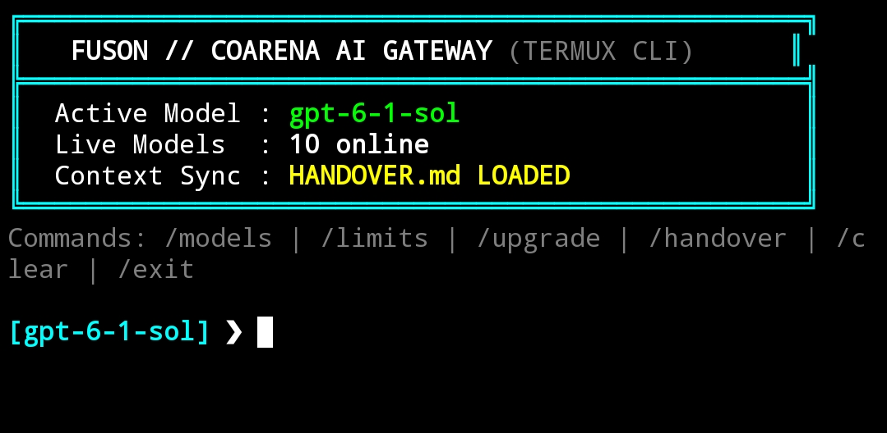
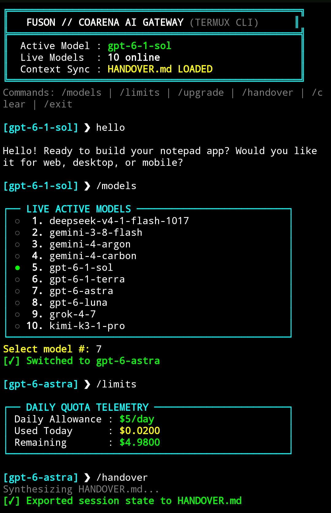

<div align="center">

# FUSON // Coarena AI Termux CLI

**Zero-Dependency Terminal Client for Coarena AI Gateway on Android**

[-00E5FF?style=for-the-badge&logo=android&logoColor=black)](https://termux.dev)
[](https://python.org)
[](LICENSE)

<br>



</div>

---

## Overview

**Coarena Termux CLI** is a lightweight (~70MB total footprint) command-line interface engineered for Android Termux environments. Built strictly on Python standard libraries (`urllib.request`, `json`), it connects directly to the Coarena AI Gateway without external SDK bloat, Node.js runtimes, or root access.

---

## Core Engineering Features

- **Zero-Dependency Runtime:** Eliminates `openai`, `httpx`, and heavy dependency trees. Runs natively on low-RAM Android devices with instant startup.
- **Persistent Cross-Model Memory (`HANDOVER.md`):** Exports active session state, architectural decisions, and pending tasks into a local `HANDOVER.md` file. Switching models automatically injects this context into the new session system prompt.
- **Dynamic Model Hot-Swapping:** Queries `/models` in real time and switches between active frontier models (`gpt-6-1-sol`, `gpt-6-astra`, `gemini-4-carbon`, `deepseek-v4-1-flash-1017`, `grok-4-7`, `kimi-k3-1-pro`) mid-session without restarting.
- **Live Quota & Telemetry:** Queries `/limits` directly from the terminal to display daily USD allowance, exact spend, and remaining balance.
- **Automated Quota Escalation:** Built-in `/upgrade` endpoint integration to submit daily limit increase requests (`$5/day` to `$10/day`) directly from the CLI.
- **TTY-Safe Piped Installer:** Handles `curl | bash` execution cleanly by binding interactive prompts directly to `/dev/tty` and persisting environment variables in `~/.bashrc`.

---

## Terminal Interface Preview

<div align="center">
  
</div>

---

## Installation (Fresh Termux)

1. Generate an API key (`coa_...`) at **[coarena.ai/account/api/keys](https://coarena.ai/account/api/keys)**.
2. Run the automated installer in Termux (installs `curl` and `python` if missing):

```bash
(command -v curl >/dev/null || pkg install -y curl) && curl -sL https://raw.githubusercontent.com/huzefdev/coarena-termux/main/install.sh | bash
```

3. Paste your API key when prompted, then start the client:

```bash
coarena
```

To launch directly with a specific model:

```bash
coarena gemini-4-carbon
```

---

## CLI Command Reference

| Command | Function |
| :--- | :--- |
| `/models` | Fetch live available models and switch active model by index |
| `/model <id>` | Switch directly to a specified model ID |
| `/limits` | Display daily USD allowance, current usage, and remaining credits |
| `/upgrade` | Submit a daily quota increase request (`$5` to `$10/day`) |
| `/handover` | Synthesize and write current session context to `HANDOVER.md` |
| `/clear` | Reset active conversation history in memory |
| `/exit` | Terminate the CLI session |

---

## Repository Structure

```text
coarena-termux/
├── install.sh              # Interactive Termux setup and environment binder
├── src/
│   └── cli.py              # Core Python HUD client and API handler
├── scripts/
│   └── uninstall.sh        # Clean binary and bashrc removal script
├── docs/
│   └── WORKFLOW.md         # Architecture and HANDOVER.md specification
├── LICENSE                 # MIT License
└── README.md               # Technical documentation
```

---

## Security & Data Handling

- API credentials are stored locally in `$HOME/.bashrc` and transmitted exclusively via HTTPS `Authorization: Bearer` headers to `coarena.ai/api/v1`.
- Do not transmit passwords, private keys, or sensitive personal records through third-party inference gateways.
